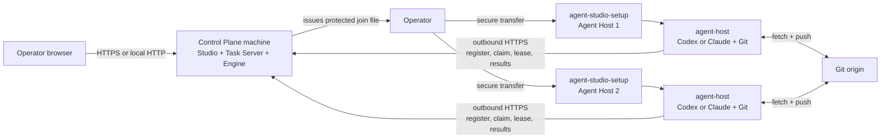

# Multi-machine setup

Use this guide when a Windows native Task Server or Linux Control Plane and one
or more Agent Hosts run on different machines. Windows uses
`agent-studio-setup.exe`; Linux can use `install.sh` or the released setup
executable. The Control Plane machine needs no Agent CLI. Each Linux x64 Agent
Host needs Git and an installed Codex or Claude CLI; Studio guides authentication
after join. No .NET SDK or runtime is required because all shipped binaries are
self-contained.

## Topology



Agent Hosts make outbound requests to the Task Server and separate Git requests
to registered origins. A reverse SSH tunnel exposes the Windows Task Server on
Linux loopback; LAN and public routes use trusted HTTPS.

## Import an existing Windows workspace

Copy the workspace task store and each Git checkout to paths on the Linux
Control Plane before enabling project actions. Set `TaskRepository` and any
bootstrap `WatchPaths` in the Linux `appsettings.Local.json` to Linux paths.
Existing project registry records retain their old paths until imported.

Use `POST /api/projects/path-import` with a Windows prefix and the matching
server prefix. The default dry run reports every project as `ready`,
`unmapped`, `missing-checkout`, or `missing-storage`. Review the report, then
send the same request with `"apply": true`. Ready records update together;
records without a checkout remain in the report for manual setup. For example:

```json
{
  "mappings": [
    { "windowsPrefix": "C:\\Projects", "serverPrefix": "/srv/studio/projects" },
    { "windowsPrefix": "D:\\StudioJobs", "serverPrefix": "/srv/studio/jobs" }
  ],
  "apply": false
}
```

The registry's `RepositoryPath`, `RootPath`, and legacy task
`StorageLocation` are mapped only to existing server directories. A checkout
path must contain `.git`. Copy the task store before applying its path mapping;
the import updates pointers and does not move task files. A root-only project
must also resolve to a Git checkout; the import records that checkout as its
repository path. Project URL previews in the networked browser use Studio's
HTTPS project preview route with a response-level sandbox, including when the
preview is opened in a separate tab. The server
connects to the registered URL; `localhost` therefore names the server, not
the operator's browser. The VS Code launch shortcut is available only in the
local profile. The networked status bar reads provider health from runner host
capability reports.

## Before you start

On Linux, use the verified release script or download it with the setup executable
and `SHA256SUMS` from the same release:

```sh
curl -fsSL https://github.com/agent-orc/agent-studio/releases/latest/download/install.sh | sh
```

The script verifies the setup executable; setup verifies matching archives
against `SHA256SUMS`. For an offline Linux install, pass `--release-dir <path>`
after placing the four Linux archives and `SHA256SUMS` there (Control Plane,
Agent Host, Studio, and Compose). The Windows offline package is a separate
`win-x64.zip` archive.

On Windows, download `agent-studio-setup.exe` and `SHA256SUMS` from the same
release and verify the executable before running it:

```powershell
$expected = ((Select-String '  agent-studio-setup.exe$' SHA256SUMS).Line -split '\s+')[0]
if ((Get-FileHash .\agent-studio-setup.exe -Algorithm SHA256).Hash.ToLowerInvariant() -ne $expected) {
  throw 'Windows setup checksum mismatch.'
}
```

For a Linux Control Plane or Windows HTTPS route, prepare DNS and TLS
termination. Native Linux setup serves Studio locally at
`http://127.0.0.1:4011/`; its HTTPS origin needs TLS termination. The Windows
reverse tunnel uses Linux loopback HTTP inside SSH and needs no certificate
transfer.

## 1. Install the Control Plane

On the Control Plane machine:

```sh
curl -fsSL https://github.com/agent-orc/agent-studio/releases/latest/download/install.sh \
  | sudo sh -s -- --mode control-plane --target native
```

`--target native` installs the systemd services described here; `systemd` is
accepted as the same target. Without `--target`, control-plane mode uses the
Docker Compose control plane ([control-plane-docker.md](./control-plane-docker.md)).

The guide asks for:

1. the private Task Server listener, normally
   `http://127.0.0.1:5071`;
2. the HTTPS URL visible from Agent Hosts, for example
   `https://tasks.example.com`.

It installs the Task Server, Orchestrator Engine, Studio API, BFF and UI as
one versioned unit and waits for readiness. Bootstrap an owner using the code
at `/etc/agent-orchestrator/owner-bootstrap.code` in the local Studio UI.
Configure the public origin to proxy Studio routes to the local UI over HTTPS.
Native setup includes that origin in the BFF's allowed browser origins during
install, update and rollback. Confirm from an Agent Host network:

```sh
curl -fsS https://tasks.example.com/healthz
```

### Linux Control Plane join token

For new hosts, the owner can issue `aosj2.*` from Studio Settings > First-run
checklist. The downloaded `join.token` contains a single-use runner enrolment
code, the installation id, and the selected runner id. It contains no
management bearer. Transfer the file to the Linux host, set mode 0600, and
run the one-line command shown in Studio. The installer exchanges the code
for a bound runner credential before starting the host. An expired or spent
code requires a fresh file.

After creating the owner in Studio, the control-plane console can also issue
an owner-only join file for each Linux host. It uses a single-use `aosj2.*`
enrolment code:

Legacy `aosj1.*` join files contain the Task Server URL, release version, and
current Task Server bearer credential. They are base64url encoded, not encrypted.
The checksum detects copy errors; it is not an authentication signature.

```sh
sudo ./agent-studio-setup join-token --runner-name agent-host-01 \
  --route https --server-url https://tasks.example.com \
  --join-token-file /root/agent-studio.join
```

The command reads the local protected Studio management token and prompts for
the owner login. Transfer the file over a protected channel.

### Windows native Task Server and join token

Install native services on Windows with
`agent-studio-setup.exe --mode studio --target native`. The Task Server listens
on Windows loopback at port 5071; the bundled Studio browser opens at
`http://127.0.0.1:5031/`. The native installer writes an owner bootstrap code
to `%ProgramData%\AgentOrchestrator\owner-bootstrap.code`. Use it once in
Studio to create the owner account. The Studio management bearer stays in the
protected `%ProgramData%\AgentOrchestrator\studio.token` file. The join-token
command reads it locally and prompts for the owner's Studio login. Issue one
token per Linux host from an elevated terminal:

```powershell
.\agent-studio-setup.exe join-token --runner-name agent-host-01 `
  --join-token-file "$env:ProgramData\AgentOrchestrator\host-01.join"
```

The default `reverse-tunnel` route registers and starts a keeper task named
`AgentRunner-TunnelKeeper-<host-name>` for each Linux host. Each task has its
own state directory and forwards that host's loopback port 15031 to Windows
Task Server port 5071. Issuing a token for another host leaves the earlier
host's task, mutex, and SSH target intact. By default, the SSH target is the
`--runner-name` value, so configure each host name as a resolvable SSH target
under the selected Windows account. Use `--ssh-target HOST` or
`--ssh-target USER@HOST` when its SSH alias differs. Each host uses remote
port 15031 on its own machine. Use `--remote-port PORT` to change a reverse
tunnel's Linux loopback port; the join token and keeper then use the same
port. For a private LAN address or public URL, pass
`--route lan --server-url https://LAN-NAME:PORT` or
`--route https --server-url https://PUBLIC-NAME`. Those routes require a
certificate trusted by the Linux host. The host installer probes the selected
route before it installs packages.

The `aosj2.*` file contains the selected URL, release version, installation
identity, Runner id, expiry, and Task Server enrolment code. The code expires
after ten minutes and exchanges exactly once for a Runner credential generated
by the Task Server. The credential stays on the Linux host. Transfer the file
over a protected channel, then remove it after use. Legacy `aosj1.*` tokens
are rejected because they contain reusable management credentials. Do not
paste tokens into shell history, tickets, chat, or source control.

## 2. Prepare each Agent Host

Install Git and at least one supported host CLI as the Linux user that will
execute tasks. Guided setup can start Codex device authorization or Claude
sign-in as that user. For unattended setup, authenticate beforehand:

```sh
git --version
codex --version
codex login status

# Or:
claude --version
claude auth status --text
```

Do not copy another machine's Codex or Claude credential files. The installer
checks the selected CLI version as the execution user and allows an unsigned-in
host to join. Studio then starts sign-in in that runner process.

For GitHub HTTPS access, Studio can send a token once to the selected runner
or ask it to generate a deploy key. If using a token, prepare it before the
GitHub access step:

- Prefer a fine-grained PAT owned by the organization or account that owns the
  repository. Limit it to assigned repositories and grant **Contents: Read and
  write** plus **Workflows: Read and write**.
- Use a classic PAT only as a compatibility fallback. It needs `repo` and
  `workflow`, plus organization SSO authorization when required.
- Prefer a dedicated machine account. A PAT belongs to the user who creates it,
  not to the organization.

The full repository credential and rotation contract is in
[Linux agent host: Token requirements](./linux-runner-host.md#token-requirements).

## 3. Join each Agent Host

Run on the Linux Agent Host after transferring the owner-only join file:

```sh
curl -fsSL https://github.com/agent-orc/agent-studio/releases/latest/download/install.sh \
  | sudo sh -s -- --join --join-token-file /root/agent-studio.join \
      --runner-name agent-host-01
```

The script verifies the downloaded setup executable against `SHA256SUMS` and
passes the join options through. The installer asks for the execution user,
CLI, Git probe origin, and maximum parallelism. It:

1. verifies Linux x64, Git, systemd, and the selected CLI version, then probes
   Task Server reachability and TLS; Studio guides CLI authentication after join;
2. downloads and verifies the matching `agent-host` archive only after the
   route probe passes;
3. optionally stores the GitHub credential for both repository URL forms and
   runs both read checks, then exchanges the single-use code;
4. writes the Task Server credential and a join receipt to separate protected
   files before it starts the service;
5. installs and starts the role-specific systemd service;
6. waits until the Task Server reports that exact Agent Host registration.

An already downloaded `agent-studio-setup` executable accepts the same join
options. Remove `/root/agent-studio.join` after the host registers. If service
installation or registration fails after exchange, rerun with the same join
file: setup reuses the host's protected credential. If setup failed before it
could save that credential, issue a fresh token for the same host name from the
Task Server and retry. Exchanging the fresh code replaces the earlier Runner
credential; the old credential stops working. A consumed code cannot be
exchanged again.

The coding service is `agent-host.service`. A separately installed review role
uses `agent-host-review.service`, a different identity, environment, state
directory, and resource envelope.

Native updates use `agent-studio-setup update --release-version X.Y.Z` with a
verified newer release. `agent-studio-setup rollback` reactivates the retained
previous version. Both commands preserve credentials and host data; setup
records the active release in `installation.json`.

## 4. Verify both sides

On an Agent Host:

```sh
systemctl is-enabled agent-host
systemctl is-active agent-host
journalctl -u agent-host --since '-5 minutes' --no-pager
```

In the Studio, open **Workspace Settings -> Execution Hosts**. The host name and
role must match the values entered in setup. Git capability can be:

- `ready`: read, push, and workflow updates are available;
- `ready-no-workflow-scope`: ordinary code work is available, but the PAT
  checklist must be completed before a task can change workflow files;
- `read-only`: the host is registered but new coding claims are blocked.

Add project repository URLs and assign projects to the Agent Host only after
the host is visible. The daemon always takes each project's Git origin from the
Control Plane registry.

## Repeat, update, or recover

Run the same setup executable again to repair the same release. Use a setup
binary from the target release for an upgrade so its release version and
downloaded archives stay aligned. Native Control Plane updates still use the
drain, readiness, and rollback contract in
[Release, installation, update, and rollback](../releases.md).

If registration fails, inspect the service journal first. Common causes are an
unreachable public URL, untrusted TLS, a rotated bearer credential, a CLI login
owned by another Linux user, or Git credentials that are read-only.

## Real-machine operator scenario

The installation scenario card runs this checklist on one clean Windows x64
machine and one clean Linux x64 host. Use scratch repositories and dedicated
test accounts; never put real credentials in CI or the report.

1. Install Windows native services from one verified release. Record the
   Task Server health response, Studio owner bootstrap result, and release SHA.
2. Confirm that Windows can SSH to the Linux host. Issue a token with the
   default reverse tunnel route. Confirm the keeper task is running and the
   Linux host reaches `http://127.0.0.1:15031/healthz`.
3. Transfer the protected join file. Run `install.sh --join
   --join-token-file /root/agent-studio.join --runner-name agent-host-01`.
   Record the preflight pass before the Agent Host archive is extracted.
4. Confirm the host service is active and that Studio lists `agent-host-01`.
   Inspect the host credential file permissions. Confirm no Runner credential
   exists in the Windows join file or the scenario log.
5. Try the same join file on a second scratch host. The exchange must be
   denied. Issue another token, wait ten minutes, and confirm expiry denial.
6. Repeat issuance with `--route lan` and `--route https` against prepared
   trusted HTTPS endpoints. Deliberately break each route and confirm the host
   exits before installing packages. Restore the route and confirm preflight.

Keep the machine names, release SHA, selected route, probe result, service
state, token replay and expiry results, and redacted failure logs in the
scenario card's `results/` report. Do not include join files, owner sessions,
management bearers, provider logins, or Runner credentials.
