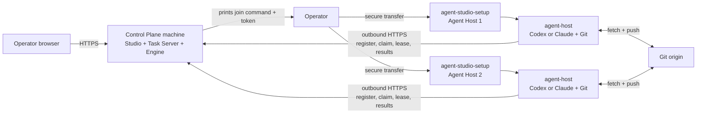

# Multi-machine setup

Use this guide when the Control Plane and one or more Agent Hosts run on
different Linux x64 machines. The same guided
`agent-studio-setup` executable is used on every machine. The Control
Plane machine needs no Agent CLI. Each Agent Host needs Git and an installed
Codex or Claude CLI; Studio guides authentication after join. No .NET SDK or
runtime is required because all shipped binaries are self-contained.

## Topology



Only the Control Plane accepts inbound application traffic. Agent Hosts make
outbound HTTPS requests to the Task Server and separate Git requests to the
registered origins.

## Before you start

On every machine, run the verified release script or download it first:

```sh
curl -fsSL https://github.com/agent-orc/agent-studio/releases/latest/download/install.sh | sh
```

The script verifies the setup executable. Setup downloads matching archives
and verifies each one against `SHA256SUMS`. Use `--release-dir <path>` on an
offline machine after placing the four archives and `SHA256SUMS` there.

Prepare the public DNS name and TLS termination for the Control Plane. The
host-visible Task Server URL must use HTTPS. Native setup serves the local UI
at `http://127.0.0.1:4011/`; a public origin still needs TLS termination.

## 1. Install the Control Plane

On the Control Plane machine:

```sh
curl -fsSL https://github.com/agent-orc/agent-studio/releases/latest/download/install.sh \
  | sudo sh -s -- --mode control-plane --target native
```

`--target native` installs the systemd services described here; `systemd` is
accepted as the same target. Without `--target`, control-plane mode uses the
Docker Compose control plane ([control-plane-docker.md](./control-plane-docker.md)).

The guide asks for:

1. the private Task Server listener, normally
   `http://127.0.0.1:5071`;
2. the HTTPS URL visible from Agent Hosts, for example
   `https://tasks.example.com`.

It installs the Task Server, Orchestrator Engine, Studio API, BFF and UI
service as one versioned unit, waits for readiness, and prints:

```text
sudo ./agent-studio-setup --join
```

and writes an owner-only join-token file in the Control Plane configuration
directory. The owner bootstrap code is stored at
`/etc/agent-orchestrator/owner-bootstrap.code`; use it in the first-owner
screen at the local UI. Configure the public origin to proxy Studio routes to
the local UI over HTTPS. Native setup includes that HTTPS origin in the BFF's
allowed browser origins and retains it during update and rollback. Confirm from
an Agent Host network:

```sh
curl -fsS https://tasks.example.com/healthz
```

### Join token handling

For new hosts, the owner can issue `aosj2.*` from Studio Settings > First-run
checklist. The downloaded `join.token` contains a single-use runner enrolment
code, the installation id, and the selected runner id. It contains no
management bearer. Transfer the file to the Linux host, set mode 0600, and
run the one-line command shown in Studio. The installer exchanges the code
for a bound runner credential before starting the host. An expired or spent
code requires a fresh file.

The older control-plane console path still prints `aosj1.*`:

The `aosj1.*` value contains the Task Server URL, release version, and current
Task Server bearer credential. It is base64url encoded, not encrypted. The
checksum detects copy errors; it is not an authentication signature.

The token is reusable until the Task Server credential is rotated. This matches
the current separated Task Server bearer contract and must not be described as
a one-time enrollment. Transfer it through the same protected administration
channel used for host access. Do not put it in shell history, tickets, chat,
task text, or source control.

Transfer the generated `join.token` over a protected channel to an owner-only
file on the Agent Host, then use `--join-token-file`. Remove the transferred
file after the host registers.

## 2. Prepare each Agent Host

Install Git and at least one supported host CLI as the Linux user that will
execute tasks. Guided setup can start Codex device authorization or Claude
sign-in as that user. For unattended setup, authenticate beforehand:

```sh
git --version
codex --version
codex login status

# Or:
claude --version
claude auth status --text
```

Do not copy another machine's Codex or Claude credential files. The installer
checks the selected CLI version as the execution user and allows an unsigned-in
host to join. Studio then starts sign-in in that runner process.

For GitHub HTTPS access, Studio can send a token once to the selected runner
or ask it to generate a deploy key. If using a token, prepare it before the
GitHub access step:

- Prefer a fine-grained PAT owned by the organization or account that owns the
  repository. Limit it to assigned repositories and grant **Contents: Read and
  write** plus **Workflows: Read and write**.
- Use a classic PAT only as a compatibility fallback. It needs `repo` and
  `workflow`, plus organization SSO authorization when required.
- Prefer a dedicated machine account. A PAT belongs to the user who creates it,
  not to the organization.

The full repository credential and rotation contract is in
[Linux agent host: Token requirements](./linux-runner-host.md#token-requirements).

## 3. Join each Agent Host

Write the token to the protected file described above, then run on the Agent Host:

```sh
curl -fsSL https://github.com/agent-orc/agent-studio/releases/latest/download/install.sh \
  | sudo sh -s -- --join --join-token-file /root/agent-studio.join
```

With `--join-token-file`, the installer reads the protected file. In a guided
run without that option, it asks for the token at a hidden prompt. It then
asks for the execution user, host name, CLI, service role, Git probe origin,
and maximum parallelism. It:

1. verifies Linux x64, Git, systemd, and the selected CLI version;
2. downloads and verifies the matching `agent-host` archive;
3. asks for a GitHub token file, a per-project deploy key, or an existing SSH
   key, then verifies read access before starting the host;
4. writes the Task Server credential to a separate protected file;
5. installs the setup command and starts the role-specific systemd service;
6. waits until the Task Server reports that exact Agent Host registration.

To use an already downloaded setup executable instead:

```sh
sudo ./agent-studio-setup \
  --mode agent-host \
  --join-token-file /root/agent-studio.join
sudo rm /root/agent-studio.join
```

The coding service is `agent-host.service`. A separately installed review role
uses `agent-host-review.service`, a different identity, environment, state
directory, and resource envelope.

Native updates use `agent-studio-setup update --release-version X.Y.Z` with a
verified newer release. `agent-studio-setup rollback` reactivates the retained
previous version. Both commands preserve credentials and host data; setup
records the active release in `installation.json`.

## 4. Verify both sides

On an Agent Host:

```sh
systemctl is-enabled agent-host
systemctl is-active agent-host
journalctl -u agent-host --since '-5 minutes' --no-pager
```

In the Studio, open **Workspace Settings -> Execution Hosts**. The host name and
role must match the values entered in setup. Git capability can be:

- `ready`: read, push, and workflow updates are available;
- `ready-no-workflow-scope`: ordinary code work is available, but the PAT
  checklist must be completed before a task can change workflow files;
- `read-only`: the host is registered but new coding claims are blocked.

Add project repository URLs and assign projects to the Agent Host only after
the host is visible. The daemon always takes each project's Git origin from the
Control Plane registry.

## Repeat, update, or recover

Run the same setup executable again to repair the same release. Use a setup
binary from the target release for an upgrade so its release version and
downloaded archives stay aligned. Native Control Plane updates still use the
drain, readiness, and rollback contract in
[Release, installation, update, and rollback](../releases.md).

If registration fails, inspect the service journal first. Common causes are an
unreachable public URL, untrusted TLS, a rotated bearer credential, a CLI login
owned by another Linux user, or Git credentials that are read-only.
