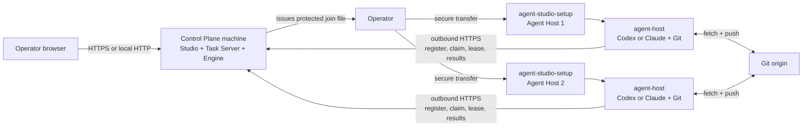

# Multi-machine setup

Use this guide when a Windows native Task Server or Linux Control Plane and one
or more Agent Hosts run on different machines. Windows uses
`agent-studio-setup.exe`; Linux can use `install.sh` or the released setup
executable. The Control Plane machine needs no Agent CLI. Each Linux x64 Agent Host needs Git and an authenticated
Codex or Claude CLI. No .NET SDK or runtime is required because all shipped
binaries are self-contained.

## Topology



Agent Hosts make outbound requests to the Task Server and separate Git requests
to registered origins. A reverse SSH tunnel exposes the Windows Task Server on
Linux loopback; LAN and public routes use trusted HTTPS.

## Before you start

On Linux machines, download the setup executable and its checksum from the same
release:

```sh
curl -fLO https://github.com/agent-orc/agent-studio/releases/latest/download/install.sh
curl -fLO https://github.com/agent-orc/agent-studio/releases/latest/download/agent-studio-setup
curl -fLO https://github.com/agent-orc/agent-studio/releases/latest/download/SHA256SUMS
grep '  agent-studio-setup$' SHA256SUMS | sha256sum -c -
grep '  install.sh$' SHA256SUMS | sha256sum -c -
chmod +x agent-studio-setup install.sh
```

The executable downloads the matching release archives and verifies each one
against `SHA256SUMS`. Use `--release-dir <path>` on an offline machine after
placing the four Linux archives and `SHA256SUMS` in that directory (Control
Plane, Agent Host, Studio, and Compose). The Windows offline package is a
separate `win-x64.zip` archive.

On Windows, download `agent-studio-setup.exe` and `SHA256SUMS` from the same
release and verify the executable before running it:

```powershell
$expected = ((Select-String '  agent-studio-setup.exe$' SHA256SUMS).Line -split '\s+')[0]
if ((Get-FileHash .\agent-studio-setup.exe -Algorithm SHA256).Hash.ToLowerInvariant() -ne $expected) {
  throw 'Windows setup checksum mismatch.'
}
```

For a Linux Control Plane or Windows HTTPS route, prepare the DNS name and TLS
termination. Caddy remains host infrastructure on Linux; the Control Plane
archive contains its site template. The Windows reverse tunnel uses Linux
loopback HTTP inside SSH and needs no certificate transfer.

## 1. Install the Control Plane

On the Control Plane machine:

```sh
sudo ./agent-studio-setup --mode control-plane --target native
```

`--target native` installs the systemd services described here; `systemd` is
accepted as the same target. Without `--target`, control-plane mode uses the
Docker Compose control plane ([control-plane-docker.md](./control-plane-docker.md)).

The guide asks for:

1. the private Task Server listener, normally
   `http://127.0.0.1:5071`;
2. the HTTPS URL visible from Agent Hosts, for example
   `https://tasks.example.com`.

It installs the Task Server and Orchestrator Engine as one versioned unit,
installs the matching static Studio files, and waits for readiness. Bootstrap
an owner before issuing host tokens. Configure the supplied Caddy template so the public
origin serves the Studio files and proxies `/api/*`, `/healthz`, and `/readyz`
to the private listener. Confirm from an Agent Host network:

```sh
curl -fsS https://tasks.example.com/healthz
```

The Linux native installer stores the owner bootstrap code at
`/etc/agent-orchestrator/owner-bootstrap.code`. After creating the owner in
Studio, issue an owner-only join file on that machine:

```sh
sudo ./agent-studio-setup join-token --runner-name agent-host-01 \
  --route https --server-url https://tasks.example.com \
  --join-token-file /root/agent-studio.join
```

The command reads the local protected Studio management token and prompts for
the owner login. Transfer the resulting file to the Agent Host.

### Windows native Task Server and join token

Install native services on Windows with
`agent-studio-setup.exe --mode studio --target native`. The Task Server listens on Windows loopback at port 5071;
the bundled Studio browser opens at `http://127.0.0.1:5031/`.
The native installer writes an owner bootstrap code to
`%ProgramData%\AgentOrchestrator\owner-bootstrap.code`. Use it once in Studio
to create the owner account. The Studio management bearer stays in the
protected `%ProgramData%\AgentOrchestrator\studio.token` file. The join-token
command reads it locally and prompts for the owner's Studio login.
Issue one token per Linux host from an elevated terminal:

```powershell
.\agent-studio-setup.exe join-token --runner-name agent-host-01 `
  --join-token-file "$env:ProgramData\AgentOrchestrator\host-01.join"
```

The default `reverse-tunnel` route registers and starts a keeper task named
`AgentRunner-TunnelKeeper-<host-name>` for each Linux host. Each task has its
own state directory and forwards that host's loopback port 15031 to Windows
Task Server port 5071. Issuing a token for another host leaves the earlier
host's task and SSH target intact. SSH access to the Linux host must
already work under the selected Windows account; use `--ssh-target HOST` when
its SSH alias differs. To use a private LAN address or a public URL instead,
pass `--route lan --server-url https://LAN-NAME:PORT` or
`--route https --server-url https://PUBLIC-NAME`. These routes require a
certificate trusted by the Linux host. The host installer probes the selected
route before it installs packages.

The `aosj2.*` file contains the selected URL, release version, installation
identity, Runner id, expiry, and a Task Server enrolment code. The code expires
after ten minutes and exchanges exactly once for a Runner credential generated
by the Task Server. The credential is written only on the Linux host. Transfer
the file over a protected administration channel, then remove it after use.
Legacy `aosj1.*` tokens are rejected because they contain reusable management
credentials. Do not paste tokens into shell history, tickets, chat, or source
control.

## 2. Prepare each Agent Host

Install Git and authenticate at least one supported host CLI as the Linux user
that will execute tasks:

```sh
git --version
codex --version
codex login status

# Or:
claude --version
claude auth status --text
```

Run the login on that host. Do not copy another machine's Codex or Claude
credential files. The setup guide checks the CLI as the selected execution
user before it writes or starts a service.

For GitHub HTTPS access, prepare a token before the credential-storage step:

- Prefer a fine-grained PAT owned by the organization or account that owns the
  repository. Limit it to assigned repositories and grant **Contents: Read and
  write** plus **Workflows: Read and write**.
- Use a classic PAT only as a compatibility fallback. It needs `repo` and
  `workflow`, plus organization SSO authorization when required.
- Prefer a dedicated machine account. A PAT belongs to the user who creates it,
  not to the organization.

The full repository credential and rotation contract is in
[Linux agent host: Token requirements](./linux-runner-host.md#token-requirements).

## 3. Join each Agent Host

Run on the Linux Agent Host after transferring the owner-only join file:

```sh
sudo ./install.sh --join --join-token-file /root/agent-studio.join \
  --runner-name agent-host-01
```

The script verifies the downloaded setup executable against `SHA256SUMS`.
The installer then asks for the execution user, CLI, Git probe origin, and maximum
parallelism. It:

1. verifies Linux x64, Git, systemd, the selected CLI version, and that CLI's
   host-owned authentication, then probes Task Server reachability and TLS;
2. downloads and verifies the matching `agent-host` archive only after the
   probe passes;
3. optionally stores the GitHub credential for both repository URL forms and
   runs both read checks, then exchanges the single-use code;
4. writes the Task Server credential and a join receipt to separate protected
   files before it starts the service;
5. installs and starts the role-specific systemd service;
6. waits until the Task Server reports that exact Agent Host registration.

Run `sudo rm /root/agent-studio.join` after the host registers. If service
installation or registration fails after exchange, rerun with the same join
file: setup reuses the host's protected credential. If setup failed before it
could save that credential, issue a fresh token for the same host name from the
Task Server and retry. Exchanging the fresh code replaces the earlier Runner
credential; the old credential stops working. A consumed code cannot be
exchanged again.

The coding service is `agent-host.service`. A separately installed review role
uses `agent-host-review.service`, a different identity, environment, state
directory, and resource envelope.

## 4. Verify both sides

On an Agent Host:

```sh
systemctl is-enabled agent-host
systemctl is-active agent-host
journalctl -u agent-host --since '-5 minutes' --no-pager
```

In the Studio, open **Workspace Settings -> Execution Hosts**. The host name and
role must match the values entered in setup. Git capability can be:

- `ready`: read, push, and workflow updates are available;
- `ready-no-workflow-scope`: ordinary code work is available, but the PAT
  checklist must be completed before a task can change workflow files;
- `read-only`: the host is registered but new coding claims are blocked.

Add project repository URLs and assign projects to the Agent Host only after
the host is visible. The daemon always takes each project's Git origin from the
Control Plane registry.

## Repeat, update, or recover

Run the same setup executable again to repair the same release. Use a setup
binary from the target release for an upgrade so its release version and
downloaded archives stay aligned. Native Control Plane updates still use the
drain, readiness, and rollback contract in
[Release, installation, update, and rollback](../releases.md).

If registration fails, inspect the service journal first. Common causes are an
unreachable public URL, untrusted TLS, a rotated bearer credential, a CLI login
owned by another Linux user, or Git credentials that are read-only.

## Real-machine operator scenario

The installation scenario card runs this checklist on one clean Windows x64
machine and one clean Linux x64 host. Use scratch repositories and dedicated
test accounts; never put real credentials in CI or the report.

1. Install Windows native services from one verified release. Record the
   Task Server health response, Studio owner bootstrap result, and release SHA.
2. Confirm that Windows can SSH to the Linux host. Issue a token with the
   default reverse tunnel route. Confirm the keeper task is running and the
   Linux host reaches `http://127.0.0.1:15031/healthz`.
3. Transfer the protected join file. Run `install.sh --join
   --join-token-file /root/agent-studio.join --runner-name agent-host-01`.
   Record the preflight pass before the Agent Host archive is extracted.
4. Confirm the host service is active and that Studio lists `agent-host-01`.
   Inspect the host credential file permissions. Confirm no Runner credential
   exists in the Windows join file or the scenario log.
5. Try the same join file on a second scratch host. The exchange must be
   denied. Issue another token, wait ten minutes, and confirm expiry denial.
6. Repeat issuance with `--route lan` and `--route https` against prepared
   trusted HTTPS endpoints. Deliberately break each route and confirm the host
   exits before installing packages. Restore the route and confirm preflight.

Keep the machine names, release SHA, selected route, probe result, service
state, token replay and expiry results, and redacted failure logs in the
scenario card's `results/` report. Do not include join files, owner sessions,
management bearers, provider logins, or Runner credentials.
