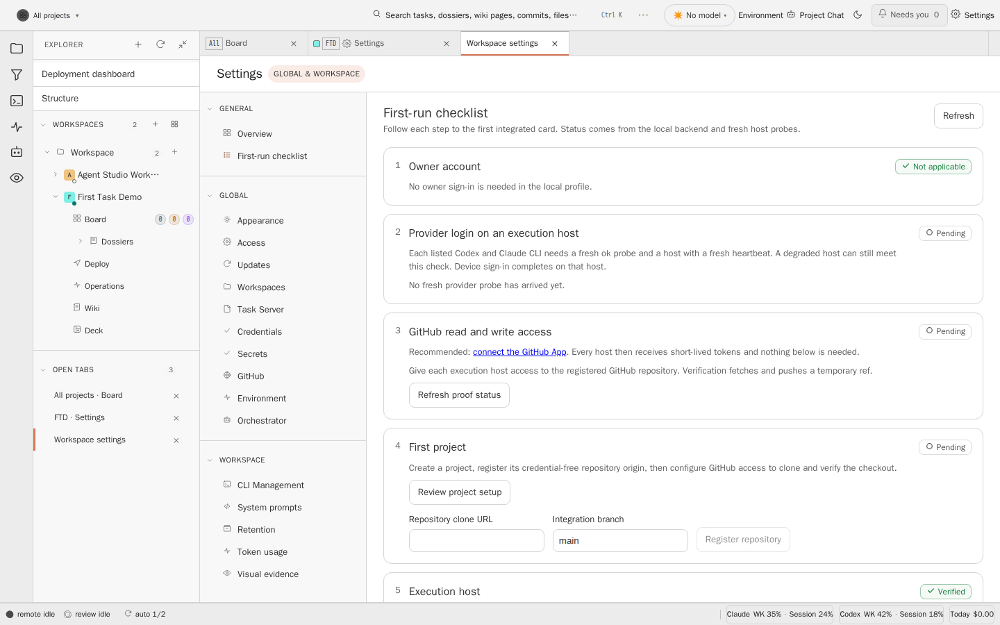
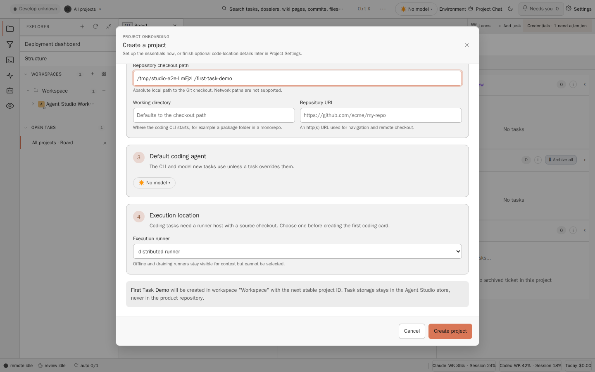
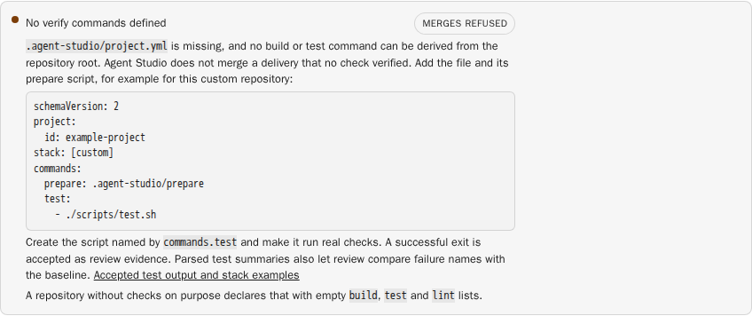
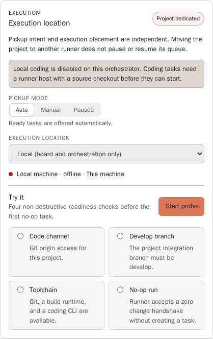
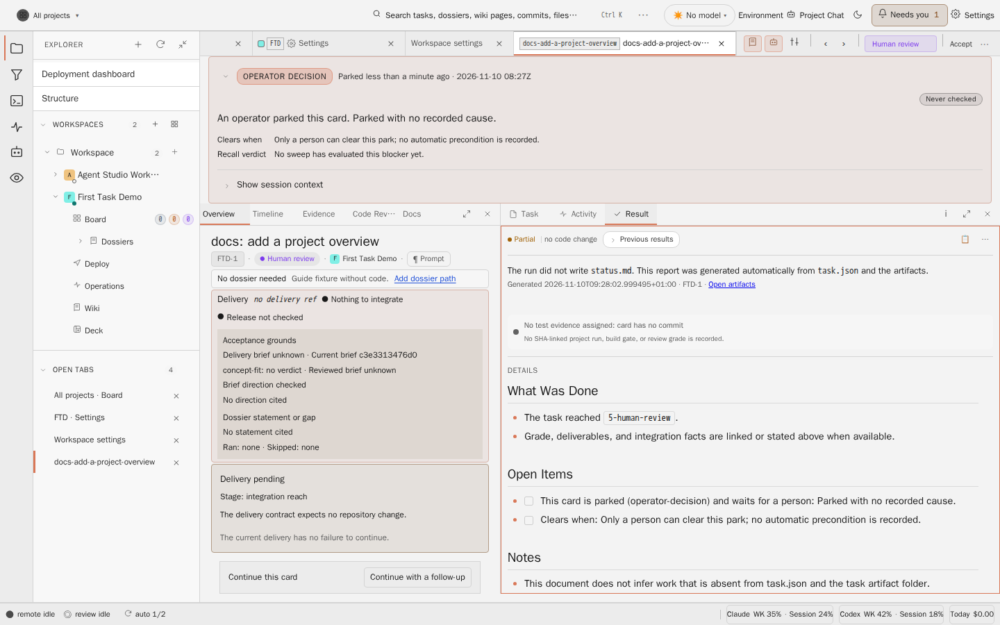

# Your first task

This walkthrough follows the current Studio UI from the first sign-in to the
first accepted card. It assumes the
[source-built Docker one-box](./docker.md#install-from-this-checkout) is
running on `http://127.0.0.1:4011`, the recommended path in the
[setup guide](./README.md#choose-your-path). The screenshots come from
`frontend/e2e/settings/your-first-task-guide.spec.ts`; see
[Refresh the screenshots](#refresh-the-screenshots).

The order matters: a card only runs when the project has an execution host,
pickup mode **Auto**, and a repository that Studio can verify through
`.agent-studio/project.yml`.

## 1. Sign in as the owner

Open `http://127.0.0.1:4011`. The first sign-in creates the owner account with
the one-time owner code that the stack generated:

```sh
docker compose exec task-server-dev cat /run/agent-studio-secrets/owner_bootstrap_code
```

Do not paste the code into a task, chat, or log. It is consumed when the owner
exists.

## 2. Work through the first-run checklist

While no project exists, Studio opens **Settings > First-run checklist** after
sign-in. It is always available there later (`#/workspace/settings/first-run`).
Each step shows **Verified** or **Pending**, read from the Task Server and
fresh host probes; **Refresh** reads them again.



1. **Owner account**: verified after step 1 above. In the local profile, no
   owner sign-in is needed; the step reads **Not applicable** and does not
   block the proof run.
2. **Provider login on an execution host**: each listed Codex and Claude CLI
   needs a fresh `ok` authentication probe on a host with a fresh heartbeat.
   A degraded host, for example one above its CPU target, still meets this
   check. An `ok` badge whose host or probe is stale shows why it does not
   count. Choose **Sign in** next to the host's Codex or Claude badge and
   finish the device sign-in.
3. **GitHub read and write access**: recommended is **connect the GitHub App**
   ([github-app.md](./github-app.md)). Otherwise choose the **Access method**
   (**Generated deploy key** or **GitHub token**), then **Configure access on
   host** and **Verify read and write**. Verification fetches and pushes a
   temporary ref from a fresh temporary repository that holds only the
   selected credential. For a project without a checkout, it also clones the
   registered URL into backend-managed storage and records that checkout on
   the project.
4. **First project**: **Create project** opens the dialog in step 3 of this
   guide. Then register the credential-free **Repository clone URL** and
   **Integration branch** with **Register repository**.
5. **Execution host**: verified when a host's heartbeat reaches the Task
   Server. In the one-box stack, `distributed-runner` (coding) and
   `distributed-review-runner` (review) are already running. Elsewhere, start
   a runner next to the source checkout in **Workspace Settings > Execution
   Hosts > Set up agent host**
   ([host walkthrough](./linux-runner-host.md#product-onboarding-from-execution-hosts));
   it needs access to the project's Git origin and the Task Server.
6. **Proof run**: covered in step 6 of this guide.

## 3. Create the project

Choose **Create project** in the checklist, or the **+** button on a workspace
row in the Explorer (tooltip "Create project in this workspace"). The
**Create a project** dialog has these parts:

- **Repository setup**: **Use an existing repository**, or **Create a new
  repository** on GitHub from a template.
- **Identity**: workspace, **Display name**, **Short code** (2 to 6 uppercase
  letters or digits, starting with a letter; task keys use it), and colour.
- **Code location** (optional now): **Repository checkout path**, **Working
  directory**, and **Repository URL**. These register where the source is;
  they do not make the orchestrator a coding host. For a project that runs on
  a runner host, the URL is enough; the host resolves its own checkout.
- **Default coding agent**: the CLI and model new tasks use.
- **Execution location**: the **Execution runner** that runs this project's
  coding tasks. Choose the runner host, `distributed-runner` in the one-box
  stack; the dialog preselects the first available one. When local coding is
  disabled, the orchestrator is listed as **Local (board and orchestration
  only)**, and a project with a checkout cannot be created on it: the dialog
  says "Local coding is disabled on this orchestrator. Start a runner host
  next to the source checkout and select it here." and keeps **Create
  project** disabled. Offline and draining runners are listed but cannot be
  selected.



Choose **Create project**. The project appears on the board immediately; no
restart is needed. Details and the API form: [onboard-a-project.md](./onboard-a-project.md).

## 4. Add `.agent-studio/project.yml`

Studio merges a delivery only when a check verified it, or when the repository
declares on purpose that it has none. Until the repository has
`.agent-studio/project.yml`, or a root `.sln`/`.csproj` or `package.json`
scripts from which commands can be derived, Project Settings shows **No verify
commands defined** with the badge **Merges refused** and a generated schema 2
example for the repository's stack.



Commit the file and an executable prepare script to the integration branch of
the product repository, for example for a Node repository:

```yaml
schemaVersion: 2
project:
  id: my-project
stack: [node]
commands:
  prepare: .agent-studio/prepare
  build:
    - npm run build
  test:
    - npm test
  lint: []
```

```sh
#!/bin/sh
set -eu
npm ci
```

```sh
git add .agent-studio/project.yml .agent-studio/prepare
git update-index --chmod=+x .agent-studio/prepare
git commit -m "chore: add Agent Studio project definition"
```

Schema 2 needs the `project.id` block; an existing schema 1 file without it
stays valid. A repository without checks declares that with empty `build`,
`test` and `lint` lists; the gate then records **No build/test defined** and merges.
The authoring rules and the smallest valid file are in
[pipeline.md](../../system/domains/pipeline.md#minimal-repository-execution-definition-aow-15).

**Test reports.** Review reruns each `test` command on the delivery and on the
integration branch. Each command must print a summary that names at least one
completed test, such as `dotnet test` (`Total tests: N`), Vitest or Jest
(`Tests N passed`), or TAP output from `node --test` (`# tests N`). A test
command that exits without such a report is retried once and then settles as
`ReviewInfra/TestReportUnavailable` (or `BaselineUnavailable` for the
integration branch), so the card does not integrate. Do not list a command
that runs zero tests; leave `test` empty instead. Details:
[review.md](../../system/domains/review.md) ("Missing test reports").

## 5. Set pickup mode to Auto

Open the project's **Project Settings**. The **Execution location** card holds
two independent controls:

- **Pickup mode**: **Auto** ("Ready tasks are offered automatically."),
  **Manual** (only explicit starts), or **Paused** (holds pickup and keeps the
  location). Choose **Auto**.
- **Execution location**: the host, the same choice as in the dialog. Change
  it here if the project still says **Local**.

If the project still runs on **Local**, the card warns "Local coding is
disabled on this orchestrator. Coding tasks need a runner host with a source
checkout before they can start." Ready cards then show an
`execution-placement` pickup hold whose **Open Project Settings** button
leads to this card. Select the runner host to clear it. **Try it** (**Start probe**) checks the code channel, develop branch,
toolchain, and a no-op run on the selected host.



## 6. Queue the first task

Two ways, both small and checkable:

- **Proof run** in the checklist: tick "This project is a disposable demo
  repository." and choose **Create sample card**. It queues "First-run proof:
  add a project overview" in **Ready**, and the checklist follows it through
  coding, review, and integration. The button is enabled only after the
  other five steps are verified.
- **Add task** on the board or in the project tab, with a prompt such as:

  > Title: `docs: add Project Overview doc`
  >
  > ```
  > Read the repository's existing README and top-level folders to understand
  > what this project is. Write a short overview at docs/project-overview.md
  > covering:
  > - what the project does (1 paragraph)
  > - the main folders and what lives in each
  > - how to run it locally (commands only, no setup theory)
  >
  > Keep it under 80 lines. End your reply with [[TASK_DONE]].
  > ```
  >
  > Lane: **Ready** · CLI: the one you signed in on the host

Tasks that look small but tell you nothing:

| Don't queue | Why |
|---|---|
| Single-line questions such as "what is 1 + 1" | The agent answers and exits without a file change. No diff, no commit, no signal. |
| "Refactor module X" without a brief | Open scope; the run is long and the failure mode unclear. |
| "Run all tests and report" | Exercises no write path and depends on test quirks the agent does not know yet. |
| Anything that needs unwritten repository conventions | Day-one tasks should work from a cold read of the README. |

## 7. Watch it run

The board shows the card moving **Ready -> In Progress -> Post Processing ->
Human review**:

- **Ready**: with pickup mode **Auto**, the selected host claims the card.
- **In Progress**: the Activity Log streams the CLI's tool calls; the detail
  panel shows a live `git diff` once the agent writes.
- **Post Processing**: the build and test gate runs the `project.yml`
  commands, and review runs on the review host.
- **Human review**: waiting for your decision. A card that needs a decision
  earlier lands in **Escalated** instead.

If the card stays in **Ready**, check the pickup mode and execution location
(step 5) and the checklist's provider step.

## 8. Review and Accept

Open the card in **Human review**. The **Result** tab shows the run summary
and the review grade; **Code Review** and **Evidence** show the diff and the
review evidence. The header holds the lane action:

- **Accept** moves the card to **Accepted**. Until the delivery is integrated
  into the integration branch, the button reads **Await integration** and is
  disabled.
- The **More task actions** menu (**⋯**) offers **Send back to Ready (re-do)**
  and **Send to Backlog**.



The screenshot's card was placed in **Human review** by the test, so it also
carries an operator-decision banner and no review grade. A card that went
through a real run shows its review result in the same places.

When the overview document is in the integration branch and the card is in
**Accepted** (or the checklist shows the proof run as **Verified**), the
installation works end to end. From there, queue real work and leave pickup
on **Auto**.

## Creating tasks programmatically

To script task creation (bulk seeds, follow-up batches, triage), use the Task
API instead of the dialog. Read
[the Task API skill](../../../.agents/skills/task-api/SKILL.md) first. It covers
the operator token file for a networked installation, project identity (send
the short code or `PROJ-NNN` id in the `project` field rather than a raw
`watchPath`), and ready-to-use Node templates. Keep `agent` and `cliType` on
the same real CLI value (`claude`, `codex`, `copilot`, or `gemini`).

If something goes sideways, check [troubleshooting.md](./troubleshooting.md)
before opening a bug.

## Refresh the screenshots

The images in `images/your-first-task/` come from the isolated Playwright
stack. The runner list in the dialog is the only stubbed response, because
that stack has no runner host:

```sh
PW_DOC_SCREENSHOTS=1 npm --prefix frontend run e2e -- e2e/settings/your-first-task-guide.spec.ts
```
