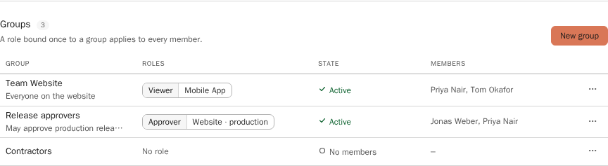
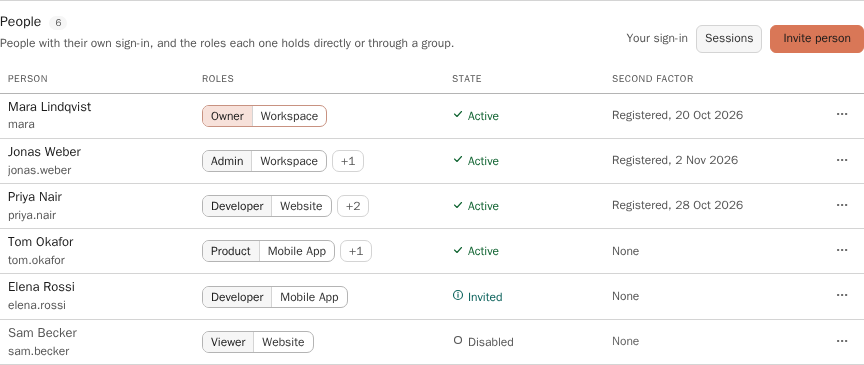
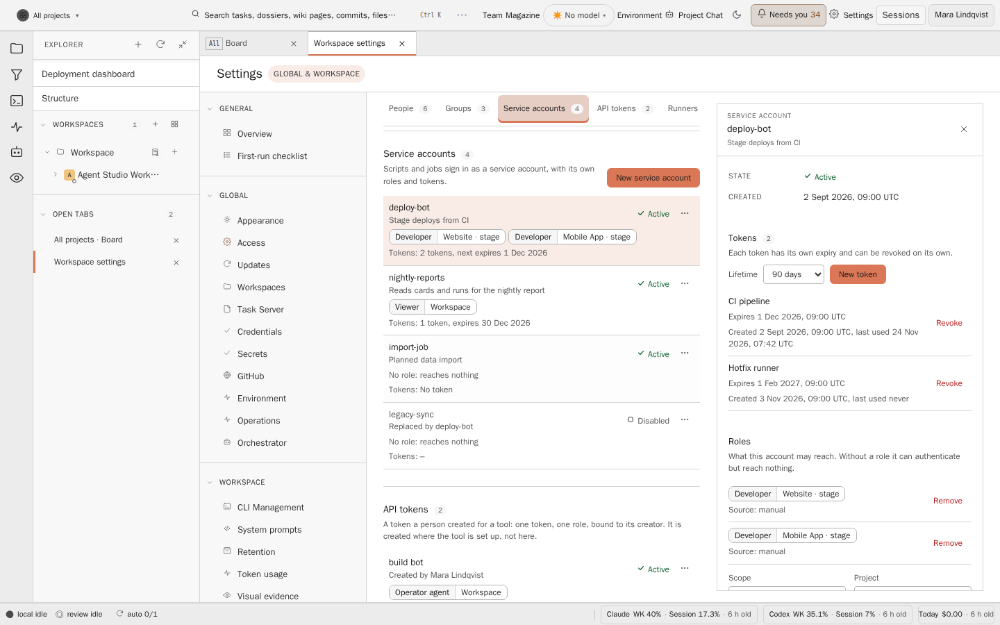
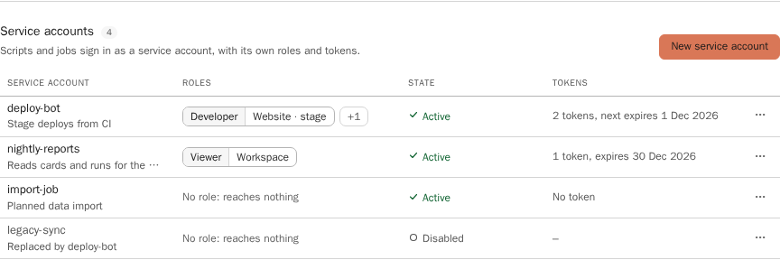
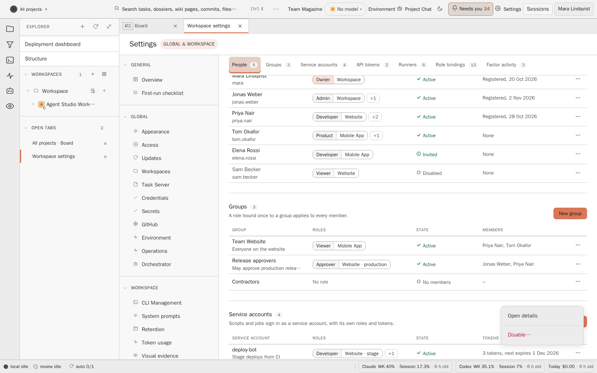
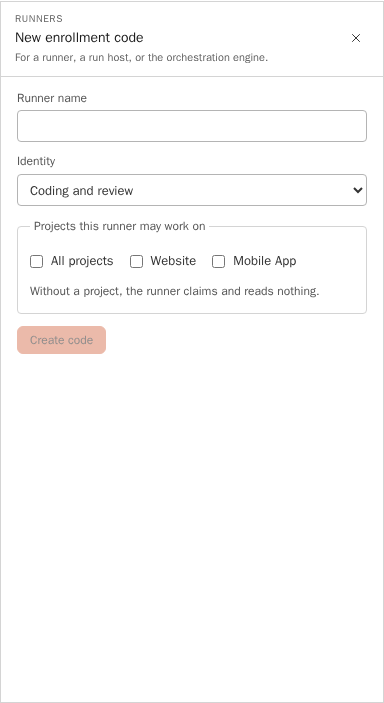
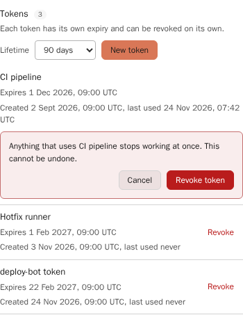
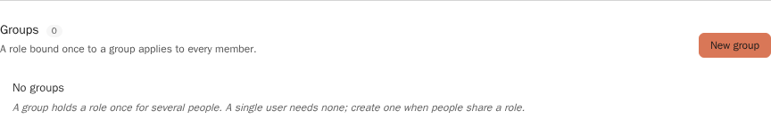
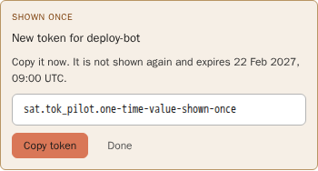

# Access page pilot: patterns for the UI standard

Settings > Access is the pilot page of the look-and-feel overhaul (AGT-4029).
This page records the patterns that were used there, each with one screenshot
and its rule, and the shared components behind them. It is the input for the
UI standard and for the visual design skill: a pattern becomes part of the
standard once the owner has reviewed the pilot page.

Status: pilot, awaiting owner review. Nothing here is rolled out to other pages
yet.

The screenshots show mocked data (`frontend/e2e/settings/access-pilot.fixture.ts`)
in the light theme at 1440 px. The run that produced them also captured the
dark theme and 390 px; `frontend/e2e/settings/access-pilot.spec.ts` regenerates
all of them.

## What the page had to solve

An owner must see at a glance who and what has access to what, and act on it
without searching. Before the pilot the page was 4617 px tall at 1440 px
(7858 px on a phone), drew five kinds of principals in six list shapes, kept
five creation forms open at all times, and gave every destructive action the
look of a harmless one. The findings are listed in the task result
(`status.md`, section "What made the page confusing").

## Patterns

### 1. Section

**Rule.** A section is a heading with the count of what it lists, one sentence
that says what belongs there, and at most one primary action, in that order on
one line. Sections are flat: one hairline and spacing separate them, never a
card.

- The count equals the rows the section shows (hard rule R3).
- A part of a section (`level="sub"`) is one heading level down and has no
  hairline: "Enrolled runners" and "Enrollment codes" under "Runners".
- Component: `<app-page-section>`.

### 2. Outline

**Rule.** A page with more than four sections gets an outline: one entry per
section with the same count as the section, a jump on click, and a mark on the
section in view. It is one sticky line above the sections on a narrow layout
and a column beside them from 1180 px of page width.

- The outline replaces a separate summary strip: the counts are stated once.
- The current entry reads the shared navigation tokens (`--studio-nav-active-*`).
- Component: `<app-page-outline>`.

### 3. Grid

**Rule.** Every list on a page is the same grid: one header, rows of one
height, and columns placed by role in a fixed order: identity, summary, state,
meta, actions. Grids on one page share their column widths, so the columns line
up from section to section.

| Role | What it holds | On the Access page |
|---|---|---|
| identity | Who or what, with one quieter second line | Name and username, description, or id |
| summary | What the row is about | Roles and scopes; identity and projects of a runner |
| state | One `<app-status-indicator>` | Active, Invited, Disabled, Revoked, Open, Used |
| meta | One fact that decides whether to act | Second factor, members, tokens and next expiry, credential expiry |
| actions | One "more" menu | Open details, then the destructive action |

- A cell never grows the row: text is cut with an ellipsis, chips that do not
  fit are counted (`+2`), and the full value is in the detail.
- A missing value is one muted en dash (ADM-17).
- Below 760 px of its own width a grid stacks its rows without turning them
  into cards: identity, state and actions on the first line, summary and meta
  below, each meta fact with its column name.
- Component: `<app-data-grid>` with `GridColumn` and `appGridCell`.

### 4. Row detail

**Rule.** A grid never nests content under a row. Selecting a row opens the one
detail area of the page; it shows everything about that row and every action on
it, and another selection replaces it.

- The detail is a panel that pushes the page and stays in view while the page
  scrolls. Beside an open panel the grids take their stacked form. Below 760 px
  of page width the panel covers the page as a sheet.
- Opening moves focus into the detail. Escape or Close returns it to the row.
- The same panel holds the form that creates an entry (pattern 5).
- Blocks inside the detail are sub-level sections: "Tokens", "Roles",
  "Members".
- Components: `<app-detail-layout>`, which uses the existing `<app-sidesheet>`
  for the panel chrome.

### 5. Action placement

**Rule.** One primary action per section, in the section head, and it creates
the thing the section lists. Everything that acts on one row is reached from
that row: the row itself opens the detail, and the "more" menu at the end of
the row lists "Open details" first and the destructive action last, after a
separator.

- A creation form opens in the detail area and is closed otherwise; its submit
  button is the one primary action of the form.
- Inside the detail, "New token" is primary because it is what an owner opens a
  service account for; adding a role is secondary.
- Buttons use the shared vocabulary only: `.btn--primary`, `.btn` (secondary),
  `.btn--ghost`, `.btn--danger`.
- Components: `<app-overflow-menu>` on the existing text-only `<app-menu>`.

### 6. Chips for role and scope

**Rule.** A value that is not a state is a chip in sentence case. A role
binding is one chip with two segments, read as "role in scope": `Developer |
Website · stage`. A state is never a chip; it is an `<app-status-indicator>`.

- One emphasis only: the Owner role, the break-glass role of the installation.
- A role a person holds through a group is a quiet chip in the grid and names
  its group in the detail.
- Component: `<app-chip>`.

### 7. Confirm in place

**Rule.** A destructive action is one quiet red button, set apart: last in its
row, and for the whole object last in the detail under a hairline. The first
press changes nothing. It turns the button into a tinted strip with one
sentence of consequence, Cancel (focused) and the named action. Escape cancels
the confirmation before it closes the detail.

- A destructive entry of a row menu ends in an ellipsis and opens the detail
  with this confirmation already open.
- Before the pilot only "Disable user" asked; revoking a token, disabling a
  service account, deleting a group, removing a role, revoking a runner or a
  code acted on the first click.
- Component: `<app-inline-confirm>`. The app-wide confirm dialog stays for
  destructive actions that have no detail area.

### 8. Empty state

**Rule.** An empty grid shows no header and no dash row. It says in a title
what is missing and in one sentence what belongs there or how it gets there.

- Component: the existing `<app-empty-state>`, projected into the grid.

### 9. Secret reveal

**Rule.** A secret is shown once, in one marked place directly where it was
requested: the eyebrow "Shown once", what it is for, when it expires, the value
in the product's monospace font, a copy control and Done. It stays until the
reader dismisses it and is dropped when another row is opened or access is
refused.

- The same place serves a service account token, an enrollment code, an
  invitation link and a temporary password.
- Component: `<app-secret-reveal>`; host commands under an enrollment code use
  the existing `<app-copyable-command>`.

## Shared components

All of them live under `frontend/src/app/components/` and read only Studio
tokens for colour, type and spacing. Stylelint enforces that for the new files
(`frontend/.stylelintrc.json`, block "AGT-4029 UI standard pilot").

### Added

| Component | Folder | Purpose |
|---|---|---|
| `<app-page-section>` | `page-section/` | Section frame: heading, count, purpose, one primary action, flat body; `level="sub"` for a part of a section. |
| `<app-page-outline>` | `page-outline/` | Outline of a page with counts, jump and current-section mark; vertical or one horizontal line. |
| `<app-data-grid>`, `appGridCell`, `GridColumn` | `data-grid/` | Standard grid: columns by role, one row height, row selection from a named identity button, stacked rows when narrow, projected empty state. |
| `<app-detail-layout>` | `detail-layout/` | Master and detail on one page: sticky push panel, sheet when narrow, focus handover, Escape. |
| `<app-chip>` | `chip/` | Neutral chip with an optional second segment and a muted note; three emphasis levels. |
| `<app-inline-confirm>` | `inline-confirm/` | Destructive action confirmed in place, with two-way `armed` so a menu can open it. |
| `<app-secret-reveal>` | `secret-reveal/` | One-time secret with copy control and dismissal. |
| `<app-overflow-menu>` | `overflow-menu/` | "More" button that opens the shared menu for one row or object. |

Shared SCSS mixins in `frontend/src/styles/_mixins.scss`:

| Mixin | Purpose |
|---|---|
| `action-buttons` (extended) | Now also provides `.btn--ghost`, `.btn--danger` and the quiet destructive trigger `.btn--ghost.btn--danger` to components with encapsulated styles. |
| `form-control`, `form-field` (new) | The convergence target of the forms guide for plain inputs and selects, and the label that names a control from above. |

### Reused

| Component or primitive | Used for |
|---|---|
| `<app-sidesheet>` | Chrome of the detail panel: eyebrow, title, subtitle, close, scrolling body. |
| `<app-menu>` | The row context menu (text only, destructive rows marked). |
| `<app-status-indicator>` | Every state: account, group, token, code, runner, credential expiry. |
| `<app-empty-state>` | Empty grids and the empty scope view. |
| `<app-count-badge>` | Counts in section headings and in the outline. |
| `<app-row>` | Label and value facts in the detail. |
| `<app-copyable-command>` | Host commands of a run host enrollment code. |
| `<app-studio-icon>` | The "more" glyph. |
| `ModalStackService` | Escape closes the confirmation, then the detail, then nothing else. |
| Mixins `type-label`, `icon-button`, `thin-scroll`, `deck-section-head`, `deck-section-title`, `deck-section-desc` | Column headings and eyebrows, the menu trigger, the outline line, the page head. |
| Tokens | `--studio-spacing-*`, `--studio-font-size-*`, `--studio-row-min-h-*`, `--studio-action-*`, `--studio-card-pill-*`, `--studio-nav-active-*`, `--studio-status-*` through the indicator, `--studio-target-coarse-min`, `--font-mono`. |

## Applied on the pilot page

| Section | Grid columns | Detail |
|---|---|---|
| People | Person, Roles, State, Second factor | State and factor, roles with add and remove, sessions, password reset, Disable or Enable |
| Groups | Group, Roles, State, Members | Members with add and remove, roles, Delete |
| Service accounts | Service account, Roles, State, Tokens | Tokens with New token and Revoke, roles, Disable |
| API tokens | API token, Role, State, Token | Role with its description, creator, the token with Revoke, Disable |
| Runners: enrolled runners | Runner, Identity and projects, State, Credential | Identity, projects with edit, credential and expiry, Revoke |
| Runners: enrollment codes | Code for, Identity and projects, State, Expires | Facts of the code, Revoke |
| Role bindings by scope | Principal, Role, Source | A row opens its principal |
| Factor activity | Event, Actor, Session, Time | None: an audit list |

The Owner-only operator sections (operator agents, approval requests, standing
grants, kill switch, break-glass windows, operator activity) and backup
activity sit in the same section frame and outline. Their inner layout is
unchanged in the pilot.

## Not part of the pilot

- No route, permission or API change. Every action the page had is still
  there; `frontend/e2e/settings/access-pilot.spec.ts` walks all of them.
- No typed `<app-button>` or form components: buttons and fields stay on the
  shared mixins until the standard decides.
- No other page uses the new components yet.
